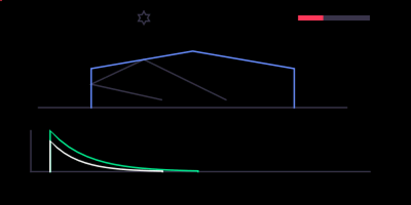

# cs hall

A wide hall reverb, with pre-delay, early reflections, width and a freeze.

## What it is

A **hall reverb**: eight delay lines feeding back into each other through a
mixing matrix (a feedback delay network), each line gently modulated and
damped so the tail darkens as it fades. Before the tank there is a pre-delay,
a set of early reflections and three diffusers. The tank's lines are split
between left and right, so the tail is wide even when the input is centred,
and the dry signal keeps its own stereo placement. Inside, the reverb runs at
half the sample rate between clean half-band filters; the dry signal stays
at the full rate.

## Before you start

- **An original OP-1** (the 2011 model) running **coop e10** or later. It is
  a coop plugin only; there is no hundekraft build.
- Install it from co-op's Plugins tab over USB, with coop chosen in
  Settings. It loads at the next power cycle.
- A plugin runs as firmware code: back up your tape and sounds first.

## Controls

Pick it from the effect list (shift + T3) at any position, FX 1 or FX 2. The
list shows it as **cs hall**. fn is Help held.

| Encoder | Turn | fn + turn | Click |
|---|---|---|---|
| blue | **size**: room to hall | **pre-delay**, 0 to 200 ms | |
| green | **decay**: 0.3 s to 20 s; the top of the range is infinite | **early**: early reflections up, the late tail down | |
| white | **damp**: how much faster the highs die away | **width**: mono to full width | |
| orange | **mix**: dry to wet | | **freeze**, a latch |

- Shift + turn is the OP-1's own fine adjust on the four knobs. Shift + fn +
  turn is the fine step of the fn controls.
- **Freeze** holds the tail: no new input, no loss, until you click orange
  again. It is momentary: it isn't saved, and it switches off whenever the
  effect restarts (including a switch between synth and drum).

## On screen

A hall in outline with a reflection path inside it, which grows with size.
Below it the decay envelope stretches with decay (an infinity sign at the
top of the range or while frozen), and a second, shorter envelope shows the
damping. The bar at the top right is the mix, and the star at the top turns
orange while freeze is on. While fn is held the screen shows the fn layer:
the pre-delay gap on the left, the early taps against the late tail, and
the width marks at the top right.

## Tips

- It runs in stereo at every position, so width works on a synth or drum
  sound too, not only on the master.
- With decay at the top, or frozen, the tail rings forever: turn the mix
  down or click freeze off to let it go.

## What is saved

The four knobs and the three fn controls (pre-delay, early, width) are
stored with the sound. Freeze is not.

## Credits and licence

- The reverb is coldsoldr's own work. Its half-rate path uses the half-band
  filters of Mutable Instruments Clouds and the soft limit of Rings, by
  Émilie Gillet (MIT).
- Licence: GPL-3.0-or-later.
  Source: https://github.com/coldsoldr/co-op/tree/main/firmware/plugins/cs_hall
