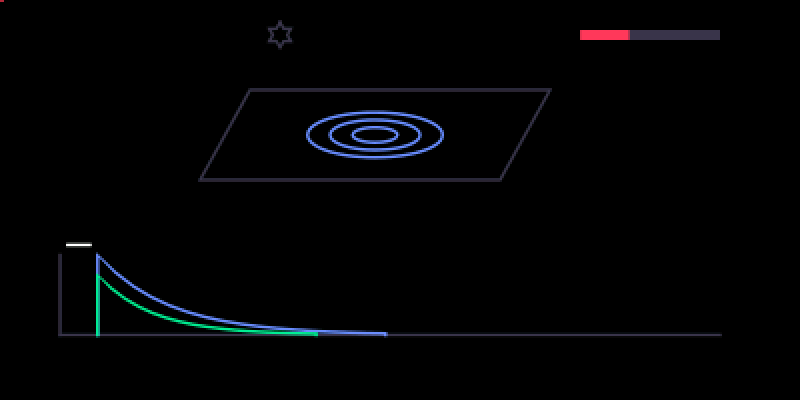

# cs plate

A plate reverb after Dattorro's classic design, with eight plate sizes,
diffusion, motion and a freeze.

## What it is

A **plate reverb**: the figure-of-eight tank Jon Dattorro published in 1997,
modelled on the plate units of the 1970s and 80s. The input passes a
pre-delay and four diffusing allpasses into two cross-coupled loops, each
with a modulated allpass, a damping filter and delay lines; the left and
right outputs are read from different points of the loops, so the tail is
dense and wide. Inside, the plate runs at half the sample rate between clean
half-band filters; the dry signal stays at the full rate.

## Before you start

- **On opus:** Opus 2 with core 2.31 or later; see On opus, below.
- **An original OP-1** (the 2011 model) running **coop e10** or later. There is no hundekraft
  build.
- Install it from co-op's Plugins tab over USB, with coop chosen in
  Settings. It loads at the next power cycle.
- A plugin runs as firmware code: back up your tape and sounds first.

## Controls

Pick it from the effect list (shift + T3) at any position, FX 1 or FX 2. The
list shows it as **cs plate**. fn is Help held.

| Encoder | Turn | fn + turn | Click |
|---|---|---|---|
| blue | **decay**: how long the plate rings | **size**: eight plate sizes, 1 to 8 | |
| green | **damp**: bright to dark | **diffusion**: how quickly echoes smear into a wash | |
| white | **pre-delay**, 0 to 200 ms | **motion**: how much the tank is modulated | |
| orange | **mix**: dry to wet | | **freeze**, a latch |

- Shift + turn is the OP-1's own fine adjust on the four knobs. Shift + fn +
  turn is the fine step of diffusion and motion; size has none.
- **Size** takes four clicks a step, on purpose: each change briefly fades
  the reverb out and back in (about 30 ms) while the plate changes length.
- **Freeze** holds the tail: no new input, no loss, until you click orange
  again. It is momentary: it isn't saved, and it switches off whenever the
  effect restarts (including a switch between synth and drum).

## On opus

`cs_plate.opmod` is the coop build ported to Opus 2 by coldsoldr's
[op1-plugins](https://github.com/coldsoldr/op1-plugins): the same sound,
screen and controls. It needs Opus 2 with core 2.31 or later.

- Download `cs_plate.opmod` from op1-plugins'
  [releases](https://github.com/coldsoldr/op1-plugins/releases), copy it into
  the `mods` folder of the OP-1's disk (disk mode: shift + COM, then T3),
  eject and restart.
- op1-plugins also has `cs_fx.opmod`, all nine coldsoldr effects in one
  file. Use either it or the single files, not both: the second copy of an
  effect is refused. Switching between them later turns the effects already
  on sounds back into the filter until you choose them again.
- Pick it from the effect list (shift + T3) on a synth or drum sound, or on
  the master in the mixer. Opus has no FX 2 slot for it.
- The controls are the ones above, with **fn** being Opus's FN key.
- At the synth and the drum it runs in mono (Opus's instrument sound is
  mono); its stereo is heard on the master.

## On screen

A plate with rings in it, more of them as decay goes up, and two envelopes
below it: decay, and decay shortened by damping. The pre-delay mark moves
the envelopes' start to the right. The bar at the top right is the mix, and
the star at the top turns orange while freeze is on. While fn is held the
screen shows the fn layer: the plate's outline at its size, diffusion bars
and the motion zigzags at the plate's edges.

## Tips

- Small sizes with high diffusion give a tight, bright plate for drums; the
  largest sizes with some motion suit pads and vocals.

## What is saved

The four knobs and the three fn controls (size, diffusion, motion) are
stored with the sound. Freeze is not.

## Credits and licence

- The plate is coldsoldr's fixed-point implementation of Dattorro's design
  ("Effect Design Part 1", JAES 1997). Its half-rate path uses the half-band
  filters of Mutable Instruments Clouds, by Émilie Gillet (MIT).
- Licence: GPL-3.0-or-later.
  Source: https://github.com/coldsoldr/co-op/tree/main/firmware/plugins/cs_plate
