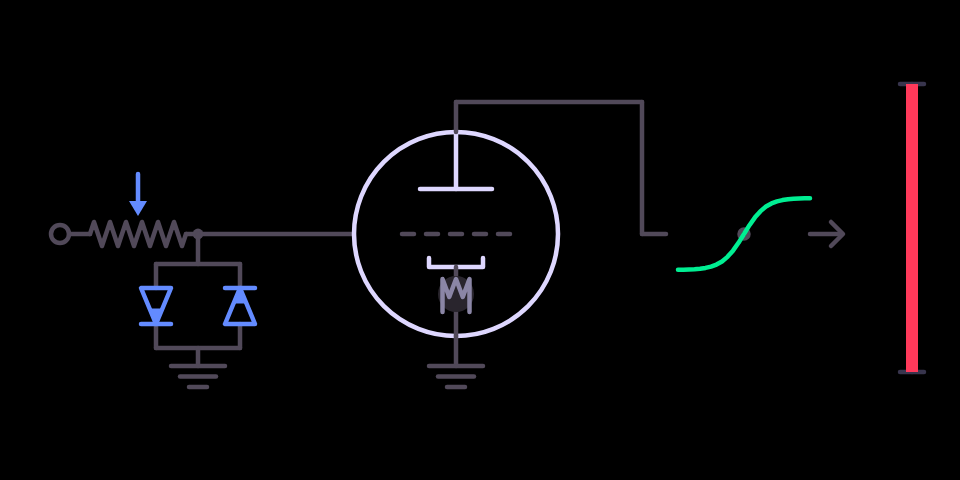

# drive

A valve-style overdrive with tone and bias.

## What it is

An **overdrive**. The signal is pushed into a soft clipper that rounds the
peaks off, with a tone control after it and a **bias** that makes the
clipping lopsided. Symmetric clipping adds odd harmonics, buzzy like a fuzz
pedal; asymmetric clipping adds even harmonics, warmer like a valve. The
level stays roughly constant as the drive goes up, and it runs oversampled
so it stays clean of aliasing.

## Before you start

- **An original OP-1** (the 2011 model). It does not run on the OP-1 field
  or the OP-Z.
- **hundekraft 3.0.3** on it, from the
  [hundekraft workshop](https://hundekraft.github.io/op1-workshop/).
- Install it from co-op's Plugins tab over USB, or drop `drive.knl` onto
  **Your plugins** in the hundekraft workshop. Either way the OP-1 asks you
  to press T1 to install, then restarts.
- A plugin runs as firmware code: back up your tape and sounds first. If the
  OP-1 ever fails to start after you add a plugin, switch it off and on
  again: it starts once without plugin files, and you can remove the file
  from the workshop.

## Controls

| Encoder | Main page | Press, then turn |
|---|---|---|
| blue | **drive**: how hard the signal hits the clipper, 0 to +36 dB | **input gain** −6 to +6 dB (Shift: tenths) |
| green | **tone**: a tilt after the clipper, dark anticlockwise, bright clockwise, flat at the centre | |
| white | **bias**: symmetric (odd harmonics) to lopsided (even harmonics) | |
| orange | **mix**, auto-levelled | |

## Second pages and Shift

- Pick it as any effect: hold Shift and press T3 on a synth or drum sound,
  or on the master in the mixer, and choose **drive**.
- Pressing **blue** turns the blue knob into the **input gain** (−6 dB to
  +6 dB, 0 dB at the centre) while it is pressed, and the screen shows a
  bracket and a dB readout. Release the knob and the page closes.
- On the second page, holding Shift makes each click a tenth of a dB. On the
  main page the OP-1's own Shift fine-adjust applies as it does to the stock
  engines.

## On screen

A valve stage. The blue diode pair fills from the tips as drive goes up, the
valve's filament and glow warm with bias, and the green curve on the right
tilts with tone. The wiper on the input pot is the input gain; while blue is
pressed the dB readout appears. The orange bar at the right edge is the mix.

## Tips

- It is stereo on the master and mono on a synth or drum sound.

## What is saved

The four knobs and the input gain are stored with the sound, as the stock
knobs are.

## Credits and licence

- The DSP, the OP-1 glue and the screen are coldsoldr's own work, built on
  hundekraft's kennel plugin SDK.
- Licence: GPL-3.0-or-later, with the OP-1 firmware permission of the SDK.
  Source: https://github.com/coldsoldr/te-op1-cfw
