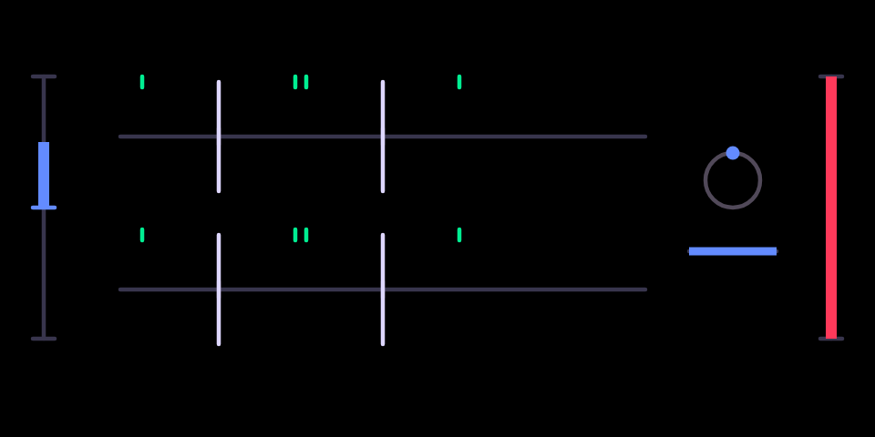

# ensemble

Chorus to string-machine ensemble.

## What it is

A **chorus / string ensemble**. Copies of the signal are delayed by a few
milliseconds and the delays are swept by slow LFOs, so the copies drift in
pitch against each other. With one copy per side it is a classic chorus,
wide and shimmering. With three phase-spread copies per side it becomes the
ensemble sound of 1970s string machines like the Solina: lush, thick and
slowly swirling. The stock OP-1 has no chorus.

## Before you start

- **An original OP-1** (the 2011 model). It does not run on the OP-1 field
  or the OP-Z.
- **hundekraft 3.0.3** on it, from the
  [hundekraft workshop](https://hundekraft.github.io/op1-workshop/).
- Install it from co-op's Plugins tab over USB, or drop `ensemble.knl` onto
  **Your plugins** in the hundekraft workshop. Either way the OP-1 asks you
  to press T1 to install, then restarts.
- A plugin runs as firmware code: back up your tape and sounds first. If the
  OP-1 ever fails to start after you add a plugin, switch it off and on
  again: it starts once without plugin files, and you can remove the file
  from the workshop.

## Controls

| Encoder | Main page | Press, then turn |
|---|---|---|
| blue | **rate**: LFO speed, 0.05 to 8 Hz | **input gain** −6 to +6 dB (Shift: tenths) |
| green | **depth**: how far the delays sweep | |
| white | **voices**: one sweeping copy per side (chorus) to three (ensemble) | |
| orange | **mix** | |

## Second pages and Shift

- Pick it as any effect: hold Shift and press T3 on a synth or drum sound,
  or on the master in the mixer, and choose **ensemble**.
- Pressing **blue** turns the blue knob into the **input gain** (−6 dB to
  +6 dB, 0 dB at the centre) while it is pressed, and the screen shows a
  bracket and a dB readout. Release the knob and the page closes.
- On the second page, holding Shift makes each click a tenth of a dB. On the
  main page the OP-1's own Shift fine-adjust applies as it does to the stock
  engines.

## On screen

Two lanes, left and right (the second appears on the master). Each voice is
a green mark that sways about its home on the lane with the LFO, further
with depth and faster with rate; more marks appear as voices goes up. The
dot on the dial at the right circles at the LFO rate, and the blue bar under
it is the rate. The orange bar at the right edge is the mix.

## Tips

- It is stereo on the master and mono on a synth or drum sound. The second
  lane only acts on the master.
- Ensemble runs its core at half the audio rate behind filters, to fit the
  processor; it restarts cleanly after a pause.

## What is saved

The four knobs and the input gain are stored with the sound, as the stock
knobs are.

## Credits and licence

- The DSP, the OP-1 glue and the screen are coldsoldr's own work, built on
  hundekraft's kennel plugin SDK.
- Licence: GPL-3.0-or-later, with the OP-1 firmware permission of the SDK.
  Source: https://github.com/coldsoldr/te-op1-cfw
