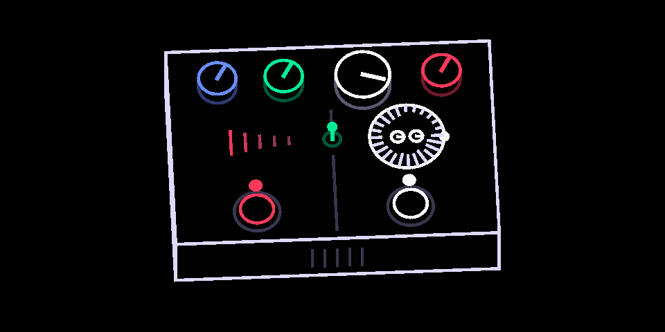

# fickle

Two effects that feed each other: a reverb, delay or slip channel and a
micro-looper that is always listening, on one shared clock.

## What it is

fickle splits your sound three ways. The **dry** sound goes straight to the
mix, untouched. The **wet channel** is a reverb, a delay or a slip (a
sampler that keeps grabbing and replaying what you just played), with a
freeze. The **micro-looper** is always recording the last moment of sound,
your playing plus the wet channel, so when you click loop it plays back what
just happened. You can then overdub onto it, and route the loop through the
wet channel.

Both channels run at one **clock**: a sample rate from 32 kHz down to 2 kHz.
Turning it down makes the loops and delays longer and the sound darker and
grittier, with aliasing at the bottom. Sound already recorded changes pitch
when the clock moves.

The design is inspired by the signal flow of a two-channel micro-looper
pedal.

## Before you start

- **On opus:** Opus 2 with core 2.31 or later; see On opus, below.
- **An original OP-1** (the 2011 model) running **coop e10** or later. There
  is no hundekraft build.
- Install it from co-op's Plugins tab over USB, with coop chosen in
  Settings. It loads at the next power cycle.
- A plugin runs as firmware code: back up your tape and sounds first.

## Controls

Pick it from the effect list (shift + T3) at any position, FX 1 or FX 2. fn
is Help held.

| Encoder | Turn | fn + turn | Click |
|---|---|---|---|
| blue | **time**: the wet channel's size, delay time or refresh (see below) | **wet mode**: reverb, delay, slip (wraps round) | |
| green | **modify**: the wet channel's smear, feedback or speed (see below) | **routing**: in, both, loop | **dub**, a latch |
| white | **clock**: 2 kHz to 32 kHz | **loop mode**: 13 ways to play the loop (wraps round) | **loop**, a latch: off is listening, on is playing |
| orange | **mix**: dry against both channels, 50 % at the start | | **freeze**, a latch |

Shift + turn is the OP-1's own fine adjust on the four knobs.

**The wet modes:**

| Mode | time | modify | freeze |
|---|---|---|---|
| reverb | size, and with it the decay: 0.5 s to 10.6 s at 24 kHz, longer at a lower clock | smear: from a clean cluster of echoes to a washed reverb | holds the tail as a pad |
| delay | 5 ms to 0.68 s at 24 kHz (up to 8 s at 2 kHz); changing it does not bend the echoes already playing | feedback; near the top it holds like a looper | the echo loops for ever |
| slip | how often it grabs fresh sound | speed and direction in 14 steps: reversed x2 to x0.5 on the left, forward x0.5 to x2 on the right (octaves, fifths, fourths, a tone) | grabs from the same place every time: a repeating tone |

**Routing** says what the wet channel hears while the loop plays: `in` your
live playing, `both` your playing and the loop, `loop` the loop alone. While
the loop is off (listening), the wet channel always hears your playing.

**The loop modes:**

| Mode | What the loop does |
|---|---|
| tape 1 | plays forwards at the recorded speed |
| tape 2 | forwards at double speed, an octave up |
| tape .5 | forwards at half speed, an octave down |
| tape 1.5 | forwards, a fifth up |
| rev 1 | backwards |
| rev 2 | backwards at double speed |
| rev .5 | backwards at half speed |
| ping | forwards, then backwards at each end |
| env soft | your playing restarts the loop from its start; the loop follows your level and fades about 0.35 s after you stop |
| env hard | louder playing jumps to the next of 8 slices of the loop, at full level |
| stretch | the loop at its own pitch, twice as long |
| str slow | the loop stretched almost to a standstill |
| str rev | stretched and played backwards |

**The latches:**

- **loop** (white click): on captures the last loop's worth and plays it;
  off fades it out and goes back to listening. The next click on captures a
  new loop. The loop is about 1 second long at 24 kHz and up to 12 seconds
  at 2 kHz.
- **dub** (green click) only works while the loop plays. It adds your
  playing to the loop, never the wet channel, so it can't run away. Older
  layers fade a little on each pass.
- **freeze** (orange click) holds the wet channel, as the table above says.
- All three are momentary: they aren't saved, and they switch off whenever
  the effect restarts (including a switch between synth and drum).

## On opus

`fickle.opmod` is the coop build ported to Opus 2 by coldsoldr's
[op1-plugins](https://github.com/coldsoldr/op1-plugins): the same sound,
screen and controls. It needs Opus 2 with core 2.31 or later.

- Download `fickle.opmod` from op1-plugins'
  [releases](https://github.com/coldsoldr/op1-plugins/releases), copy it into
  the `mods` folder of the OP-1's disk (disk mode: shift + COM, then T3),
  eject and restart.
- fickle comes as its own file only; it is not part of `cs_fx.opmod`. It
  goes beside either the single effect files or `cs_fx.opmod`.
- Pick it from the effect list (shift + T3) on a synth or drum sound, or on
  the master in the mixer. Opus has no FX 2 slot for it.
- The controls are the ones above, with **fn** being Opus's FN key.
- At the synth and the drum it runs in mono (Opus's instrument sound is
  mono); its stereo is heard on the master.

## On screen

A pedal with two footswitches, seen from above at an angle, drawn in
outline. It wobbles, and it leans towards whichever channel is louder. The
clock is the screen's frame rate too: at a low clock the pedal moves in
jerky steps, like a low sample rate.

- The four **knobs** turn with time (blue), modify (green), clock (white,
  the big one) and mix (orange).
- The left half shows the **wet mode**: dots that spread with modify for
  reverb, bars that drift right for delay, a zigzag with an arrow showing
  the direction for slip. It turns orange and stops while frozen.
- The green **lever** in the middle leans towards the wet side for `in`,
  stands up for `both` and leans towards the loop for `loop`.
- The right half is the **loop ring**. While listening it is dim and a dot
  runs round it where the looper is recording. While the loop plays it is
  white, the ticks show the loop's loudness round its length and the dot is
  the play position. A green ring inside shows dub. In its centre a small
  sign shows the loop mode: two turning reels, a spike for env, or
  stretched lines.
- The **footswitches** press down and their lights come on for freeze
  (orange, left) and loop (white, right); the loop light blinks while you
  dub.

## Tips

- Leave the loop off and just play: the looper is always listening, so the
  moment you hear something worth keeping, click loop.
- Route the loop through a frozen reverb (`loop` routing, then freeze) for a
  pad that keeps the loop's rhythm inside it.
- Turn the clock down while a loop plays to drop its pitch and make it
  longer and grittier, as slowing a tape does.
- env hard with a busy loop turns your playing into a slice trigger.
- It runs in stereo at every position on coop.
- CPU: in the Blackfin simulator it uses about 13,000 to 28,000 cycles a
  block at the default clock, and more at the top of the clock with the
  loop playing and dubbing. The figure on the OP-1 itself is higher; if you
  hear crackles, turn the clock down a little.

## What is saved

The four knobs and the three fn controls (wet mode, routing, loop mode) are
stored with the sound. Freeze, loop and dub are not, and a captured loop is
not kept when the effect restarts.

## Credits and licence

- fickle is coldsoldr's own work.
- Licence: GPL-3.0-or-later, with the OP-1 firmware permission.
  Source: https://github.com/coldsoldr/co-op/tree/main/firmware/plugins/fickle
