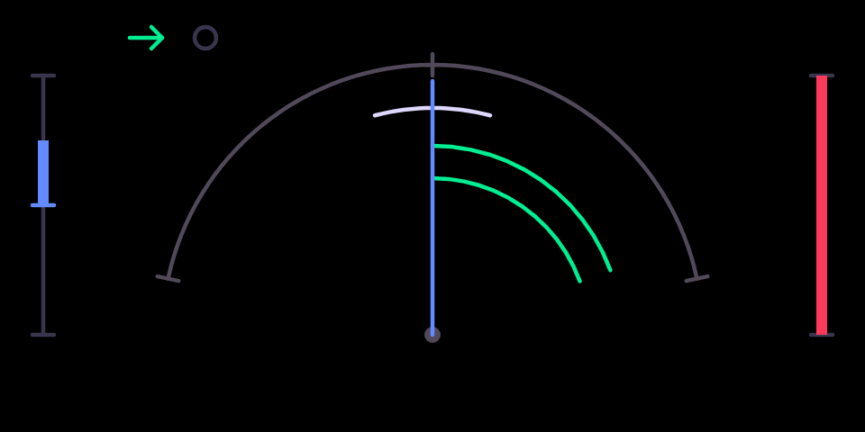

# freq shift

A Bode frequency shifter and ring modulator, with barber-pole feedback and
stereo spread.

## What it is

Two effects in one, picked on the green knob's second page:

- **Frequency shifter** (Bode style, the algorithm from Mutable Instruments
  Warps). It moves every frequency in the sound up or down by the same
  number of hertz. Unlike pitch shifting, the harmonics stop lining up:
  small shifts give a phasing, beating shimmer, large ones turn sounds
  clangorous and bell-like. **Feedback** sends the output back in, so the
  sound climbs or falls endlessly like a barber-pole. On the master,
  **spread** shifts the left channel up and the right down for instant
  width.
- **Ring modulator** (Warps' diode model). It multiplies the sound by a
  sine wave at the shift frequency, giving the sum and difference
  frequencies: robotic, metallic, Dalek voices.

## Before you start

- **An original OP-1** (the 2011 model). It does not run on the OP-1 field
  or the OP-Z.
- **hundekraft 3.0.3** on it, from the
  [hundekraft workshop](https://hundekraft.github.io/op1-workshop/).
- Install it from co-op's Plugins tab over USB, or drop `freq_shift.knl`
  onto **Your plugins** in the hundekraft workshop. Either way the OP-1 asks
  you to press T1 to install, then restarts.
- A plugin runs as firmware code: back up your tape and sounds first. If the
  OP-1 ever fails to start after you add a plugin, switch it off and on
  again: it starts once without plugin files, and you can remove the file
  from the workshop.

## Controls

| Encoder | Main page | Press, then turn |
|---|---|---|
| blue | **shift**: −2 kHz to +2 kHz, 0 at the centre, fine near 0 (ring mod: the carrier frequency) | **input gain** −6 to +6 dB (Shift: tenths) |
| green | **feedback**: output back into the input, barber-pole sweeps | **mode**: frequency shifter or ring modulator, one click flips it |
| white | **spread**: left shifted up and right down by this much (master only) | |
| orange | **mix** | |

## Second pages and Shift

- Pick it as any effect: hold Shift and press T3 on a synth or drum sound,
  or on the master in the mixer, and choose **freq shift**.
- Pressing **blue** turns the blue knob into the **input gain** (−6 dB to
  +6 dB, 0 dB at the centre) while it is pressed, and the screen shows a
  bracket and a dB readout. Release the knob and the page closes.
- Pressing **green** and turning picks the **mode**: one click flips between
  the frequency shifter and the ring modulator.
- On the second page, holding Shift makes each click a tenth of a dB. On the
  main page the OP-1's own Shift fine-adjust applies as it does to the stock
  engines.

## On screen

A dial. The blue needle is the shift; on the master it splits into two
needles as spread parts the channels. The green arcs show the feedback and
its direction, climbing or falling, and ripples spread from the hub as the
input plays. The marks at the top left show the mode: the arrow for the
shifter, the circle for the ring modulator; a bracket surrounds them while
green is pressed. The orange bar at the right edge is the mix.

## Tips

- It is stereo on the master and mono on a synth or drum sound. Spread only
  acts on the master.

## What is saved

The four knobs, the input gain and the mode are stored with the sound, as
the stock knobs are.

## Credits and licence

- The frequency shifter and ring modulator are ported from Mutable
  Instruments Warps by Émilie Gillet (MIT), bit-exact where the hardware
  allowed and credited in each source file.
- The OP-1 glue and the screen are coldsoldr's own work, built on
  hundekraft's kennel plugin SDK.
- Licence: GPL-3.0-or-later, with the OP-1 firmware permission of the SDK.
  Source: https://github.com/coldsoldr/te-op1-cfw
