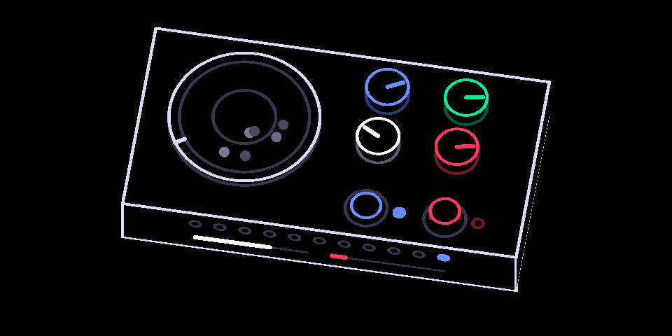

# petri

A granular micro-loop effect: eleven ways to replay what you just played.

## What it is

petri records your sound all the time into a short stereo buffer, about 1.5
seconds long. One of eleven effects plays that buffer back through up to
eight voices: loops, grains, slices, arpeggio notes or delay taps, each with
its own start, speed, direction and length. The result goes through a shared
tone section on the wet sound only: a gentle pitch drift, a resonant
low-pass filter and a small reverb-like space. It is then mixed with your
dry sound, which petri never touches.

**Hold** stops the recording, so the effect keeps working on the slice it
holds while you play over it. **Reverse** plays everything backwards. There
is no long phrase looper: the OP-1's tape is the looper.

The design is inspired by the signal flow of a granular micro-loop pedal.
Inside, the effect runs at half the sample rate between clean half-band
filters; the dry sound stays at the full rate.

## Before you start

- **Three builds, one per firmware:** `petri.coop` for coop, `petri.knl` for
  hundekraft and `petri.opmod` for opus. The Plugins tab offers the one for
  the firmware chosen in Settings. The controls on hundekraft differ (see On
  hundekraft, below); the rest of this section and Controls are about coop.
- **An original OP-1** (the 2011 model) running **coop e10** or later. It
  does not run on the OP-1 field or the OP-Z.
- Install it from co-op's Plugins tab over USB, with coop chosen in
  Settings. It loads at the next power cycle.
- **On hundekraft:** hundekraft 3.0.3; see On hundekraft, below.
- **On opus:** Opus 2 with core 2.31 or later; see On opus, below.
- A plugin runs as firmware code: back up your tape and sounds first.

## Controls

Pick it from the effect list (shift + T3) at any position, FX 1 or FX 2. fn
is Help held.

| Encoder | Turn | fn + turn | Click |
|---|---|---|---|
| blue | **time**: the length the effect works with (a loop, a grain, a slice, a step, a tap); its range depends on the effect | **effect**: mosaic, seq, glide, haze, tunnel, strum, blocks, cut, arp, pattern, warp (wraps round) | **reverse**, a latch |
| green | **activity**: how busy the effect is (layers, density, notes, taps) | | |
| white | **repeats**: how long things come back (decay, passes, feedback, or how often, per effect) | **filter**: a resonant low-pass on the wet sound, 150 Hz to 10 kHz | |
| orange | **mix**: dry to wet, 50 % at the start | **space**: none to a wash | **hold**, a latch |

- Shift + turn is the OP-1's own fine adjust on the four knobs. Shift + fn +
  white and shift + fn + orange are the fine steps of filter and space.
- The filter never closes completely: at the bottom it sits at 150 Hz, and
  its resonance rises a little in the lower part of its range.
- Changing the effect fades the voices out and starts the new effect on the
  same buffer, so what you just played carries over.
- **Reverse** applies to every voice that starts after the click; voices
  already playing finish as they were.
- **Hold** freezes the buffer at the moment you click. The effect keeps
  playing from it, and strum, blocks and arp play the held notes on a clock.
- Both latches are momentary: they aren't saved, and they switch off
  whenever the effect restarts (including a switch between synth and drum).

## The eleven effects

| Effect | What it does | time | activity | repeats |
|---|---|---|---|---|
| mosaic | overlapping loops of one slice at 1x, 2x, 0.5x and 1.5x speed, spread across the stereo field | loop, 30 ms to 0.96 s | layers, 1 to 4 | how long each repeat lasts |
| seq | short slices of the last few steps, rearranged into a rhythm, sometimes reversed, doubled or an octave up | step, 40 to 172 ms | how much the order changes | passes before it grabs new sound |
| glide | staggered loops whose pitch glides up or down each time they repeat | loop, 30 ms to 0.96 s | layers, 2 to 4, and how far they glide | how long each repeat lasts |
| haze | a cloud of overlapping grains taken from the last second, slightly detuned | grain, 20 to 453 ms | density and spread; octaves join at the top | feedback |
| tunnel | very short loops that turn into a drone, at the loop's pitch, an octave down and an octave up | the drone's period, 8 to 314 ms | layers, 1 to 3 | how long the drone sustains |
| strum | the last notes you played, replayed one after another like a strummed chord | gap between notes, 15 to 240 ms | notes, 2 to 6 | strums back the other way, each softer |
| blocks | your playing sets off glitches: stutters at double or half speed, reversed or accelerating | block, 10 to 243 ms | how wild the glitches are | stutters per burst |
| cut | bursts that cut in, pitched an octave up or down, a fifth or two octaves | burst, 20 to 393 ms | which intervals and how many stutters | how often: from every 4 s to every 0.2 s |
| arp | the last few notes you played, sequenced as an arpeggio of octaves and fifths | step, 60 to 591 ms | steps, 1 to 8 | note length |
| pattern | a multi-tap delay whose taps fall on sixteenths of a bar | bar, 0.1 to 1.39 s | taps, 1 to 6 | feedback |
| warp | three taps at a third, two thirds and all of the time, each pitched and filtered, feeding back into cascades | the longest tap, 60 ms to 1.1 s | how far the taps are pitched | feedback |

strum, blocks and arp listen for the start of each note you play (an
onset). A note held for a long time counts as a new onset once a second.

## On hundekraft

`petri.knl` is the coop build for hundekraft 3.0.3's kennel plugin core,
made by coldsoldr's
[op1-plugins](https://github.com/coldsoldr/op1-plugins): the same sound and
screen. It has been tested in the OP-1 emulator but not yet on an OP-1.

- Install it from co-op's Plugins tab over USB with hundekraft chosen in
  Settings, or drop `petri.knl` onto **Your plugins** in the
  [hundekraft workshop](https://hundekraft.github.io/op1-workshop/). Either
  way the OP-1 asks you to press T1 to install, then restarts. If the OP-1
  ever fails to start after you add a plugin, switch it off and on again: it
  starts once without plugin files, and you can remove the file from the
  workshop.
- Pick it as any effect: hold shift and press T3 on a synth or drum sound,
  or on the master in the mixer, and choose **petri**. There is one effect
  slot, no FX 2.
- It is stereo on the master and mono on a synth or drum sound.

hundekraft has no fn layer. The four turns are the same as on coop; the
extra controls are on the encoder presses instead:

| Encoder | Turn | Press | On page 2, turn |
|---|---|---|---|
| blue | **time** | page 2 on or off | **effect**: mosaic .. warp, one a click (wraps round) |
| green | **activity** | page 2 on or off | **filter**, 150 Hz to 10 kHz |
| white | **repeats** | page 2 on or off | **space**, none to a wash |
| orange | **mix** | **hold**, a latch; with shift held, **reverse** | |

- A press flips only that knob to its second page; press it again to go
  back. Each knob's page stays as you left it.
- Note that filter and space are on green and white here, not on white and
  orange as on coop, and reverse is shift + orange press, not a blue click.
- On page 1, shift + turn is the OP-1's own fine adjust. On page 2, shift +
  turn moves filter and space in quarter steps.
- The screen tips forward to show the front panel (the effect lights and
  the filter and space bars) while any knob is on page 2, where coop shows
  it while fn is held.
- The four knobs and the three page-2 controls are stored with the sound.
  Hold and reverse are not.

## On opus

`petri.opmod` is the coop build ported to Opus 2 by coldsoldr's
[op1-plugins](https://github.com/coldsoldr/op1-plugins): the same sound,
screen and controls. It needs Opus 2 with core 2.31 or later.

- Download `petri.opmod` from op1-plugins'
  [releases](https://github.com/coldsoldr/op1-plugins/releases), copy it into
  the `mods` folder of the OP-1's disk (disk mode: shift + COM, then T3),
  eject and restart.
- petri comes as its own file only; it is not part of `cs_fx.opmod`. It goes
  beside either the single effect files or `cs_fx.opmod`.
- Pick it from the effect list (shift + T3) on a synth or drum sound, or on
  the master in the mixer. Opus has no FX 2 slot for it.
- The controls are the ones above, with **fn** being Opus's FN key.
- At the synth and the drum it runs in mono (Opus's instrument sound is
  mono); its stereo is heard on the master.

## On screen

A stompbox seen from above at an angle, drawn in outline. It sways slowly
and hops a little each time you play a note, higher with more activity.

- The round **dish** on the left is the buffer. The tick on its rim is where
  petri is recording now. Each dot is a voice: its angle is the place in the
  buffer it plays from, and its distance from the centre is its pitch (higher
  further out). The dots fade with each voice's envelope.
- The four **knobs** turn with time (blue), activity (green), repeats (white)
  and mix (orange).
- The two **footswitches** press down and their lights come on for reverse
  (blue) and hold (orange). While hold is on, the dish's rim turns orange and
  the recording tick disappears.
- While fn is held the box tips forward to show its front panel: eleven
  lights for the effects, the current one blue, and two bars for filter
  (white) and space (orange).

## Tips

- Start with mosaic or haze and the mix around halfway, then play short
  phrases and let the buffer fill.
- Hold is the way to make a drone or a texture from one moment: play a
  chord, click hold, then change the effect, the time and the activity
  while the held sound keeps being re-sliced.
- tunnel with short times turns any sound into a pitched drone; turn the
  filter down for something darker.
- It runs in stereo at every position on coop, so the voices' spread is
  heard on a synth or drum sound too. On hundekraft and opus the synth and
  drum are mono.
- CPU: in the Blackfin simulator it averages about 21,000 cycles a block
  (warp is the heaviest, about 29,000). The figure on the OP-1 itself is
  higher; if you hear crackles, try a lighter effect.
- glide and arp come out a little quieter than the others at the start.

## What is saved

The four knobs and the three fn controls (effect, filter, space) are stored
with the sound. Hold and reverse are not.

## Credits and licence

- petri is coldsoldr's own work. Its half-rate path uses the half-band
  filters of Mutable Instruments Clouds by Émilie Gillet (MIT).
- Licence: GPL-3.0-or-later, with the OP-1 firmware permission.
  Source: https://github.com/coldsoldr/co-op/tree/main/firmware/plugins/petri
  (coop) and https://github.com/coldsoldr/op1-plugins/tree/main/kennel/petri
  (hundekraft)
