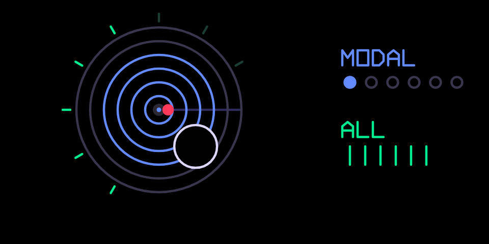

# rings

Mutable Instruments Rings as a synth engine: a physical-modelling resonator,
six models, up to six voices.

## What it is

**Mutable Instruments Rings**, the Eurorack resonator, as a synth engine. A
key strikes or bows a resonator and the resonator sings. There are six
models, chosen with the blue knob (its second page on hundekraft, fn and
blue on coop):

1. **modal**: a bank of band-pass resonators struck by the key, like a bar
   or a plate. Structure spaces them from harmonic to inharmonic.
2. **sympathetic strings**: Karplus-Strong strings that resonate with each
   other, two per voice.
3. **inharmonic string**: one string with dispersion and modulation.
4. **FM voice**: two-operator FM with feedback.
5. **quantized sympathetic strings**: the strings tuned to a chord table.
6. **string + reverb**: strings into a shared reverb.

## Before you start

There are three builds, one per firmware: `rings.knl` for hundekraft,
`rings.coop` for coop and `rings.opmod` for opus. The Plugins tab offers the
one for the firmware chosen in Settings. The sound and the four knobs are the
same on all three; the second pages differ (see On coop, below).

- **An original OP-1** (the 2011 model). It does not run on the OP-1 field
  or the OP-Z.
- **On coop: coop e5** or later. An older coop core plays it, but the model
  and polyphony controls stop at the ends instead of wrapping round; a coop
  core older than m1c refuses it. Install it from co-op's Plugins tab over
  USB.
- **On opus:** Opus 2 with core 2.31 or later; see On opus, below.
- **On hundekraft: hundekraft 3.0.3** on it, from the
  [hundekraft workshop](https://hundekraft.github.io/op1-workshop/).
- Install it from co-op's Plugins tab over USB, or drop `rings.knl` onto
  **Your plugins** in the hundekraft workshop. Either way the OP-1 asks you
  to press T1 to install, then restarts.
- A plugin runs as firmware code: back up your tape and sounds first. If the
  OP-1 ever fails to start after you add a plugin, switch it off and on
  again: it starts once without plugin files, and you can remove the file
  from the workshop.

## Controls

| Encoder | Main page | Press, then turn (hundekraft) |
|---|---|---|
| blue | **structure**: the spacing of the modes or the coupling of the strings | **model**, one of the six per click |
| green | **brightness**: how bright the excitation is and how many modes sound | **polyphony**: all (six voices), 1, 2 or 4 |
| white | **damping**: decay time, clockwise = longer | |
| orange | **position**: where the string or plate is struck | |

## Second pages and Shift (hundekraft)

- Pick it as any synth: hold Shift and press T1, turn blue to **rings**,
  press to load.
- Pressing **blue** and turning picks the **model**, one per click. Pressing
  **green** and turning sets the **polyphony**. Release the knob and the
  page closes.
- On the main page the OP-1's own Shift fine-adjust applies as it does to
  the stock engines.

## On coop

The four knobs are as on hundekraft: blue **structure**, green
**brightness**, white **damping**, orange **position**. The model and the
polyphony are on fn instead of a second page:

| Hold fn and turn | Sets | Steps |
|---|---|---|
| blue | **model** | modal, symp, string, fm, quant, verb |
| green | **polyphony** | 1, 2, 4, all |

- Both wrap around: past the last step comes the first again, and back
  from the first comes the last.
- **all** plays six voices and costs the most CPU. With effects on, or
  while recording to tape, **4** is the safe choice.
- Needs coop e5. On an older coop core the two controls stop at the ends
  instead of wrapping; a core older than m1c does not load the plugin.

## On opus

`rings.opmod` is the coop build ported to Opus 2 by coldsoldr's
[op1-plugins](https://github.com/coldsoldr/op1-plugins): the same sound,
screen and controls. It needs Opus 2 with core 2.31 or later.

- Download `rings.opmod` from op1-plugins'
  [releases](https://github.com/coldsoldr/op1-plugins/releases), copy it into
  the `mods` folder of the OP-1's disk (disk mode: shift + COM, then T3),
  eject and restart.
- Pick it as a synth engine: shift + T1 on the synth page.
- The model and the polyphony are on fn as in On coop, above, with **fn**
  being Opus's FN key.
- Changing the model or the polyphony cuts the notes still ringing.
- **symp** at polyphony **1** (eight strings a voice) is the heaviest
  setting.

## On screen

The rings light up from the centre with structure, the rays round them with
brightness. The pad at the lower right lifts off the rings as damping
rises, and the red dot is the strike position. Each voice that sounds sends
a ripple out from the core, and the core glows with the total level. The
MODEL and POLY rows on the right show the two settings; while a knob is on
its second page the row is bracketed and shown in white.

## Tips

- Fewer voices buy more detail: at polyphony 1 the single voice gets every
  mode or string the engine can afford. "All" is six voices.
- The stock T2 envelope shapes the sound after the resonator as it does for
  every engine, so set a release there if the rings cut off too early.
- **CPU.** The sound is heavy on the CPU at "all" next to big effects on the
  master; polyphony 4 leaves room. Use 4 voices, or lighter effects, when
  it crackles.

## What is saved

The four knobs, the model and the polyphony are stored with the sound, as
the stock knobs are.

## Credits and licence

- Ported from Mutable Instruments Rings by Émilie Gillet (MIT), bit-exact
  where the hardware allowed and credited in each source file.
- The OP-1 glue and the screen are coldsoldr's own work: the hundekraft
  build on hundekraft's kennel plugin SDK, the coop build on coop's plugin
  interface.
- Licence: GPL-3.0-or-later, with the OP-1 firmware permission of the SDK.
  Source: hundekraft build https://github.com/coldsoldr/te-op1-cfw, coop
  build https://github.com/coldsoldr/co-op/tree/main/firmware/plugins/rings
