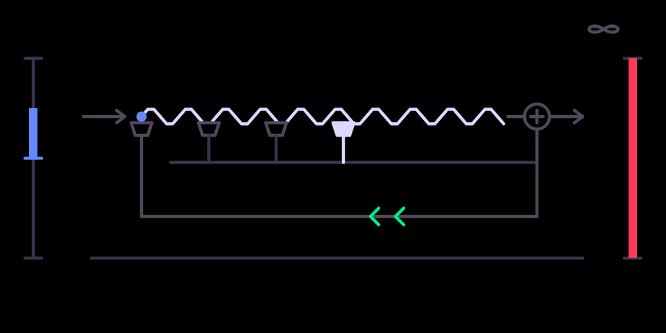

# tape echo

A three-head tape delay with tempo lock, hold and self-oscillation.

## What it is

A **tape echo** in the style of a Space Echo or an Echoplex. The sound is
recorded onto a loop of tape and played back by up to three heads at
different distances, so the repeats fall in a rhythm. Each repeat goes back
through the tape and comes out a little darker, more saturated and more
wobbly than the one before. Turned up, the feedback self-oscillates into a
dub howl. Changing the time while it repeats bends the pitch of the echoes,
as speeding up a real tape does. The wow and flutter model is from Mutable
Instruments Beads; the saturation is the same as tape drive's.

## Before you start

- **An original OP-1** (the 2011 model). It does not run on the OP-1 field
  or the OP-Z.
- **hundekraft 3.0.3** on it, from the
  [hundekraft workshop](https://hundekraft.github.io/op1-workshop/).
- Install it from co-op's Plugins tab over USB, or drop `tape_echo.knl` onto
  **Your plugins** in the hundekraft workshop. Either way the OP-1 asks you
  to press T1 to install, then restarts.
- A plugin runs as firmware code: back up your tape and sounds first. If the
  OP-1 ever fails to start after you add a plugin, switch it off and on
  again: it starts once without plugin files, and you can remove the file
  from the workshop.

## Controls

| Encoder | Main page | Press, then turn |
|---|---|---|
| blue | **time**: 30 ms to 1.5 s. **Shift + blue locks the time to the tempo**, see below | **input gain** −6 to +6 dB (Shift: tenths); scales what reaches the record head only |
| green | **feedback**: how many repeats; the top of the range self-oscillates | press = **hold** (a latch): the input is cut and the loop repeats what it holds until you press again |
| white | **age**: wow and flutter, darkening and saturation per repeat, new tape to worn | **head pattern**, one click per pattern: head 3; heads 2+3; 1+2+3; 1+3 |
| orange | **mix** | |

## Second pages and Shift

- Pick it as any effect: hold Shift and press T3 on a synth or drum sound,
  or on the master in the mixer, and choose **tape echo**.
- Pressing **blue** turns the blue knob into the **input gain** (−6 dB to
  +6 dB, 0 dB at the centre) while it is pressed, and the screen shows a
  bracket and a dB readout. Release the knob and the page closes. Here the
  input gain scales only what reaches the record head.
- Pressing **green** is **hold**, a latch: the input is cut and the loop
  repeats what it holds until you press again.
- Pressing **white** and turning picks the **head pattern**, one click per
  pattern: head 3; heads 2+3; 1+2+3; 1+3.
- On the second page, holding Shift makes each click a tenth of a dB.

**Tempo lock.** Hold Shift and turn blue on the main page: each click steps
the time through the project tempo's divisions, 1/16T, 1/16, 1/8T, dotted
1/16, 1/8, 1/4T, dotted 1/8, 1/4, 1/2T, dotted 1/4 and 1/2, shortest first,
clockwise = longer (divisions over 1.5 s at the current tempo are skipped).
The repeats stay on the grid while you play; turning blue without Shift
frees the time again. While Shift is held the screen draws a tick on the
tape for every sixteenth that fits.

## On screen

The tape runs from the record head at the left past three play heads to the
summing point. The heads slide out as the time grows, the dot travels along
the tape at the tape's speed, and the lit heads are the current pattern. The
chevrons on the return path are the feedback, the wave on the tape breathes
with age, and the ∞ at the top right lights green while hold is on, with the
input and record head dimmed. The orange bar at the right edge is the mix.

## Tips

- It is stereo on the master and mono on a synth or drum sound.
- Tape echo runs its core at half the audio rate behind filters, to fit the
  processor; it restarts cleanly after a pause.

## What is saved

The four knobs and the second-page settings (input gain and head pattern)
are stored with the sound, as the stock knobs are. Hold is a momentary
latch and is not saved.

## Credits and licence

- The wow and flutter model is from Mutable Instruments Beads by Émilie
  Gillet (MIT), credited in the source file.
- The rest of the DSP, the OP-1 glue and the screen are coldsoldr's own
  work, built on hundekraft's kennel plugin SDK.
- Licence: GPL-3.0-or-later, with the OP-1 firmware permission of the SDK.
  Source: https://github.com/coldsoldr/te-op1-cfw
